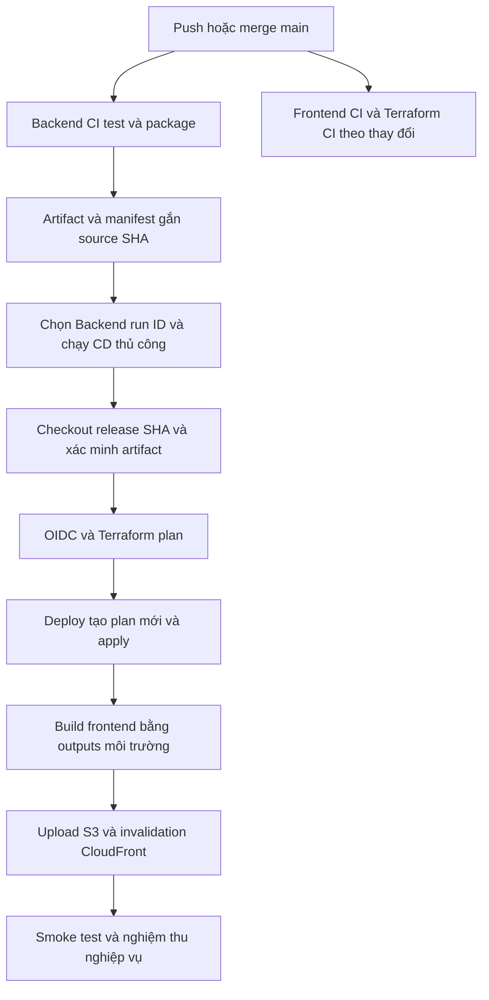

> **ARCHIVE ? T?i li?u l?ch s?, kh?ng ph?i h??ng d?n hi?n h?nh.**
> Gom ng?y 20/10/2026 t?: infrastructure/RUNBOOK-CICD.md. Ngu?n hi?n h?nh: [CONTEXT](../../CONTEXT.md), c?ng b? RUNBOOK/TROUBLESHOOTING/MONITORING trong docs/.
> N?i dung b?n d??i gi? nguy?n ?? truy nguy?n; ???ng d?n code, ID, tr?ng th?i v? l?nh c? c? th? kh?ng c?n ??ng.

# RUNBOOK — CI/CD và phát hành phiên bản Giao án Giáo lý

**Cập nhật: 15/10/2026 — Asia/Bangkok.** Repository: `pvtanh1309/Giao_an_giao_ly`. Phạm vi: GitHub Actions, Terraform, AWS và kiểm tra ứng dụng sau phát hành.

Tài liệu dựa trên code hiện tại và log/sự cố thực tế trong phiên triển khai. Người vận hành đã báo dev apply thành công và truy cập được frontend. Đây không phải một lần audit trực tiếp AWS: policy đang gắn, ID tài nguyên và phiên bản thực sự đang chạy phải đối chiếu trên Console/log.

**Đọc nhanh:** chỉ deploy code mới → mục 1. Thiết lập lần đầu → mục 2–4. Xác nhận hoạt động → mục 5. Rollback/prod → mục 6. Tra lỗi → mục 7–8. “Trade-offs” là các đánh đổi, trình bày ở mục 9.

### Mục lục

- [1. Phát hành code mới lên dev](#1-phát-hành-code-mới-lên-dev)
- [2. Hiểu hệ thống](#2-hiểu-hệ-thống-trước-khi-thao-tác)
- [3. IAM, OIDC và GitHub Environment](#3-thiết-lập-iam-oidc-và-github-environment)
- [4. CI, state và admin đầu tiên](#4-ci-bootstrap-state-và-admin-đầu-tiên)
- [5. Kiểm tra sau deploy](#5-kiểm-tra-sau-deploy-và-giới-hạn-nghiệm-thu)
- [6. Retry, rollback và prod](#6-release-identity-retry-rollback-và-prod)
- [7. Các lỗi đã gặp](#7-các-lỗi-thực-tế-đã-gặp)
- [8. Các lỗi có thể gặp tiếp](#8-lỗi-có-thể-gặp-tiếp-và-cách-chẩn-đoán)
- [9. Trade-offs](#9-trade-offs--lý-do-và-đánh-đổi)
- [10. Checklist vận hành](#10-checklist-vận-hành-và-bảo-trì-tài-liệu)

## 1. Phát hành code mới lên dev

### 1.1. Checklist trước phát hành

- [ ] Code đã commit, review và merge/push lên `main`.
- [ ] Biết source SHA muốn triển khai.
- [ ] Đã ghi lại SHA, Backend CI run ID và CD run/attempt của bản đang chạy tốt.
- [ ] Xác định thay đổi thuộc UI, backend, Terraform, IAM hay database schema.
- [ ] Không có apply khác cùng môi trường; IAM/Environment đúng dev.

PowerShell, tại root repository:

```powershell
git status --short
git log -3 --oneline
```

Chọn đúng file để commit; không dùng `git add .` khi có state, tfvars, secrets hoặc thay đổi ngoài phạm vi. Theo quy trình PR/branch protection thực tế của repo; đừng force-push main để phát hành hoặc rollback.

### 1.2. Chọn đúng CI và artifact

GitHub → **Actions**:

| Workflow | Điều cần xác nhận |
| --- | --- |
| Backend CI | Đúng commit, event `push`, nhánh `main`, test/package thành công, có artifact |
| Frontend CI | Khi UI thay đổi, job test/type-check/build thực sự chạy và xanh |
| Terraform CI | Khi infrastructure thay đổi, job validate thực sự chạy và xanh |

Backend CI hiện tạo release trên **mỗi push main**, kể cả sửa Frontend. Frontend/Terraform vẫn có bộ lọc thay đổi; skipped hợp lệ khi phần đó không thay đổi, không phải bằng chứng phần đó đã được test.

CD tự xác minh kết quả Backend CI; hiện chưa tự kiểm tra tất cả workflow CI độc lập trước apply. Người vận hành cần đối chiếu Frontend/Terraform CI liên quan. Frontend vẫn được test lại trong CD, nhưng bước đó nằm sau Terraform apply.

Vào Backend CI run của commit muốn phát hành:

1. Đối chiếu SHA, không chỉ tên commit.
2. Mục Artifacts có `lambda-release-<SOURCE_SHA>`.
3. URL `/actions/runs/38694142961` → số `38694142961` là **run ID**, không phải SHA hay run number.
4. Artifact hiện giữ 30 ngày; run thành công nhưng artifact đã hết hạn vẫn không deploy được.

Backend CI có thể hủy run cũ khi có push mới. Chờ run đúng SHA hoàn tất; không lấy run cũ chỉ vì nó đang xanh.

### 1.3. Chạy plan

**Actions → CD-DEV Pipeline → Run workflow**:

| Trường | Giá trị |
| --- | --- |
| Branch | `main` |
| `environment` | `dev` |
| `backend_run_id` | ID Backend CI mới đã xác nhận |
| `operation` | `plan` |

Đọc bước **Create deployment plan**, cả chi tiết lẫn tổng kết:

| Ký hiệu | Ý nghĩa |
| --- | --- |
| `+` | Tạo mới |
| `~` | Cập nhật tài nguyên đang có |
| `-` | Xóa |
| `-/+` hoặc `+/-` | Thay thế; xem thứ tự xóa/tạo |
| `No changes` | Không đổi hạ tầng; frontend vẫn có thể có code mới cần deploy |

Đổi run ID **chỉ chọn phiên bản code/artifact**. Terraform quyết định tạo/sửa/thay thế theo code, biến và state, không theo số run ID.

Bản sửa UI thông thường không nên tạo Cognito pool hoặc table mới. Nếu plan muốn thay thế/xóa pool, DynamoDB table, app bucket hoặc đổi state key: dừng và giải thích nguyên nhân trước deploy.

### 1.4. Chạy deploy

Tạo Run workflow mới, vẫn `main / dev` và **cùng Backend run ID vừa xem plan**, chọn `deploy`.

**Quan trọng:** deploy tạo một plan mới rồi apply plan của chính run đó; không tải saved plan từ run plan trước. State/tfvars/IAM thay đổi ở giữa có thể làm kết quả khác. Workflow chưa có bước duyệt đúng saved plan sau plan trong cùng run.

Theo dõi đến hết:

1. Kiểm tra nguồn Backend run và checkout release SHA.
2. Tải Lambda ZIPs, kiểm tra manifest/source SHA/checksum.
3. OIDC → Terraform init/validate/plan/apply.
4. Đọc outputs và cấu hình public thật.
5. Test/type-check/build frontend.
6. Upload `Frontend/out/` vào `s3://<APP_BUCKET>/frontend/`.
7. Invalidation CloudFront và chờ hoàn tất.
8. Smoke test và release summary.

**Apply xanh chưa phải deploy xong.** Backend có thể đã đổi, trong khi build/upload frontend phía sau thất bại.

### 1.5. Kiểm tra và ghi phiên bản

Mở CloudFront URL, hard refresh, làm kiểm tra nghiệp vụ ở mục 5. Ghi nhật ký:

```text
Môi trường:
Source SHA:
Backend CI run ID / URL:
CD run ID / attempt / URL:
Người triển khai và thời điểm:
Thay đổi chính:
Tài nguyên tạo/xóa/thay thế trong plan:
Kết quả smoke test và kiểm tra nghiệp vụ:
Bản tốt trước để rollback:
Sự cố / việc còn lại:
```

Không ghi password, token, access key hay request body nhạy cảm.

## 2. Hiểu hệ thống trước khi thao tác

### 2.1. Luồng triển khai



| Nguồn sự thật | File |
| --- | --- |
| CI Backend | [ci-backend.yml](../.github/workflows/ci-backend.yml) |
| CI Frontend | [ci-frontend.yml](../.github/workflows/ci-frontend.yml) |
| CI Terraform | [ci-terraform.yml](../.github/workflows/ci-terraform.yml) |
| CD | [cd-dev.yml](../.github/workflows/cd-dev.yml) |
| Xác minh Backend run | [validate_backend_run.py](../scripts/cd/validate_backend_run.py) |
| Release manifest | [create_release_manifest.py](../scripts/ci/create_release_manifest.py) |
| Lọc thay đổi | [detect_changes.py](../scripts/ci/detect_changes.py) |
| Tạo admin | [create_admin.py](../Backend/scripts/create_admin.py) |
| IAM JSON cho operator áp dụng | [iam/](iam/) |

Tên workflow **CD-DEV Pipeline** hiện cho chọn cả dev/prod. Tên hiển thị không tự hạn chế đích; input, Environment, IAM role và Terraform root mới quyết định môi trường.

### 2.2. Thông tin dự án

| Mục | Giá trị hiện cấu hình |
| --- | --- |
| GitHub repo | `pvtanh1309/Giao_an_giao_ly` |
| AWS account | `030540333236` |
| Region | `ap-southeast-1` |
| Tags | `Project=giaoan`, `Environment=dev` hoặc `prod` |
| Role dev | `arn:aws:iam::030540333236:role/giaoan-github-cd-dev` |
| Role prod dự kiến | `giaoan-github-cd-prod`; phải tạo/kiểm tra riêng |
| State bucket | `gxthaian-giaoan-web-2026` |
| Bootstrap state | `giaoan-web/bootstrap/terraform.tfstate` |
| Dev state | `giaoan-web/dev/terraform.tfstate` |
| Prod state | `giaoan-web/prod/terraform.tfstate` |
| Dev lockfile | `giaoan-web/dev/terraform.tfstate.tflock` |
| Table dev mặc định | `giaoan-dev` |
| App bucket dev mặc định | `giaoan-dev-app-030540333236` |

**ID động:** Cognito pool/client, API ID, stream ARN, CloudFront distribution ID/domain. Lấy từ outputs, Lambda environment hoặc Console đúng môi trường. ID từng xuất hiện trong lỗi là dữ liệu lịch sử, không phải giá trị để copy mãi.

State bucket chứa state/lock; app bucket chứa frontend/media. Không upload frontend vào state bucket.

### 2.3. Runtime và SQS

```text
CloudFront → static frontend trong S3 frontend/
Frontend → Cognito login → access token → API Gateway → Lambda → DynamoDB
DynamoDB Streams → Lambda cleanup → S3/Cognito
                                    ↘ lỗi vượt retry/giới hạn tuổi → SQS
```

Hai queue dev:

- `giaoan-dev-content-api-stream-failures`: lỗi cleanup media.
- `giaoan-dev-users-api-stream-failures`: lỗi cleanup tài khoản.

Retention queue hiện 14 ngày; có alarm. SQS là nơi nhận thông tin xử lý stream thất bại, không nằm trên đường CRUD thông thường. Chưa có consumer tự động replay hai queue này. Retention queue không kéo dài thời gian giữ record gốc của DynamoDB Streams; message có thể chỉ chứa metadata.

## 3. Thiết lập IAM, OIDC và GitHub Environment

Chỉ làm khi bootstrap, tạo môi trường mới hoặc sửa quyền; không cần tạo lại role mỗi release.

### 3.1. AWS profile và operator

Local PowerShell:

```powershell
aws configure list-profiles
aws sts get-caller-identity --profile "<PROFILE_OPERATOR>"
```

Profile là tên cấu hình AWS CLI local, không nhất thiết trùng `giaoan-web` hoặc `giaoan-dev`. Đối chiếu account. Trong **CloudShell**, dùng phiên Console, thường bỏ `--profile`:

```bash
aws sts get-caller-identity
```

Operator bootstrap/admin và role CD có mục đích khác nhau. Không mở rộng role CD thành admin toàn account chỉ để thao tác tiện hơn.

### 3.2. Provider và role

AWS → IAM → Identity providers:

- URL: `https://token.actions.githubusercontent.com`.
- Audience: `sts.amazonaws.com`.
- Nếu provider đã có trong account thì dùng lại.

IAM → Roles → Create role → Web identity:

| Ô | Giá trị |
| --- | --- |
| GitHub organization | `pvtanh1309`, tài khoản cá nhân cũng điền ở đây |
| GitHub repository | `Giao_an_giao_ly` |
| GitHub branch | `main` |

Tạo `giaoan-github-cd-dev`, rồi sửa Trust relationships theo token thực tế. Mẫu Console theo branch có thể không khớp job dùng Environment.

### 3.3. Trust policy đã khớp log dev

```json
{
  "Version": "2012-10-17",
  "Statement": [{
    "Effect": "Allow",
    "Principal": {
      "Federated": "arn:aws:iam::030540333236:oidc-provider/token.actions.githubusercontent.com"
    },
    "Action": "sts:AssumeRoleWithWebIdentity",
    "Condition": {
      "StringEquals": {
        "token.actions.githubusercontent.com:aud": "sts.amazonaws.com",
        "token.actions.githubusercontent.com:sub": "repo:pvtanh1309@217305811/Giao_an_giao_ly@1399787931:environment:dev"
      }
    }
  }]
}
```

Log đã quan sát: issuer là GitHub, audience `sts.amazonaws.com`, sub chứa owner ID `217305811` và repo ID `1399787931`. Tra ID bằng GitHub CLI:

```bash
gh api users/pvtanh1309 --jq '.id'
gh api repos/pvtanh1309/Giao_an_giao_ly --jq '.id'
```

**Luôn ưu tiên chuỗi sub thật của job**, không tự ghép từ trí nhớ. Prod phải đối chiếu `environment:prod` và role riêng.

Trust policy quyết định **ai được dùng role**; permissions policy quyết định **role làm được gì**. Sửa quyền S3 không chữa được lỗi assume role. [GitHub OIDC/AWS](https://docs.github.com/en/actions/how-tos/secure-your-work/security-harden-deployments/oidc-in-aws).

### 3.4. Permissions policy

IAM → role dev → Permissions → Add permissions → Create inline policy → JSON:

- [Policy chính](iam/cd-dev-policy.json).
- [Policy bổ sung](iam/cd-dev-additional-permissions.json).

Đọc trước khi gắn. **Sửa file Git không tự cập nhật AWS**; phải Save changes và mở lại policy trên đúng role để xác nhận.

Giới hạn cần nhớ:

- `BootstrapHttpApis` còn phạm vi API rộng trong region; OAC còn phạm vi account.
- Workaround `apigateway:*` chỉ trên hai stage collection ARN đã gặp lỗi, nhưng hardcode API IDs.
- Logs delivery/resource-policy có phạm vi region rộng hơn log group dev.
- Cognito MFA và mapping tag-on-create dùng tag conditions; tags sai sẽ deny.
- Quyền sửa inline policies của Lambda execution roles là quyền mạnh; tên role riêng chưa cách ly prod tuyệt đối.
- Chưa bao phủ mọi tùy chọn custom domain/DNS/certificate/budget/email subscription.
- Quota inline policies của role tính tổng; nếu quá quota, hợp nhất phần trùng/thiết kế managed policies phù hợp, không cứ thêm policy.
- Không gắn AdministratorAccess để che lỗi.

### 3.5. GitHub Environments

Repository → Settings → Environments → tạo `dev`.

| Tên | Đặt tại | Giá trị |
| --- | --- | --- |
| `AWS_DEPLOY_ROLE_ARN` | Environment variables | ARN role dev |
| `AWS_ACCOUNT_ID` | Environment variables | `030540333236` |
| `TFVARS_JSON` | Environment secrets | JSON cấu hình dev |

```json
{
  "aws_region": "ap-southeast-1",
  "project_name": "giaoan",
  "environment": "dev",
  "allowed_origins": [],
  "monthly_budget_usd": 10
}
```

Giới hạn deployment branch là `main`. Prod dùng Environment/role/secret riêng và required reviewers nếu GitHub plan hỗ trợ. Approval Environment diễn ra trước job, không phải sau plan.

`monthly_budget_usd` không tự dừng chi phí AWS. Budget chỉ được tạo khi bật `budget_email` trong code hiện tại; chỉ đặt 10 chưa tạo cảnh báo.

Không override đường dẫn Lambda ZIP; CD phải dùng ZIP đã xác minh. Không đặt access keys hoặc password user trong JSON này.

### 3.6. Quyền GitHub trong YAML

| Quyền | Mục đích |
| --- | --- |
| `contents: read` | Checkout code |
| `actions: read` | Đọc run/tải artifact; không cần write để deploy AWS |
| `id-token: write` ở job CD | Xin OIDC token; không tự cấp quyền sửa AWS |

Quyền tạo AWS resources đến từ IAM role. GitHub Environments phải tên đúng `dev`/`prod` vì tên đi vào token và lookup variables/secrets.

## 4. CI, bootstrap state và admin đầu tiên

### 4.1. Kiểm tra backend local

PowerShell tại root, Python 3.12:

```powershell
python -m venv .venv
.\.venv\Scripts\python.exe -m pip install -r Backend\requirements-dev.txt
Push-Location Backend
..\.venv\Scripts\python.exe -m pytest -q
Pop-Location
```

Nếu venv đã có thì dùng lại. Tests dùng fake/moto, không cần AWS credentials thật. Sau sửa lỗi ban đầu, suite có 229 pass; số lượng là mốc lịch sử, không phải tiêu chuẩn bất biến.

Package local khi cần kiểm tra:

```powershell
.\.venv\Scripts\python.exe Backend\scripts\package_lambdas.py
```

ZIPs nằm ở `Backend/dist/`. CI tạo manifest chứa sourceSha và SHA-256, upload artifact giữ 30 ngày. Không commit ZIP/venv/state.

### 4.2. Kiểm tra frontend local

Node 22.13.0, pnpm theo package/workflow. PowerShell:

```powershell
Push-Location Frontend
pnpm install --frozen-lockfile
pnpm test
pnpm exec tsc --noEmit
pnpm build
Pop-Location
```

Build cần cấu hình public hợp lệ; không dùng placeholder CI làm cấu hình deploy. Nếu shim pnpm local hỏng nhưng dependencies đã có, `npm test` chạy cùng script test. Không chạy npm install tùy tiện rồi commit lockfile khác.

Tests font có thể skip khi chưa có CSS build, hoặc fail với CSS cũ/không đủ glyph. CI hiện test trước build. Khi kiểm tra font, build thành công rồi chạy:

```powershell
Push-Location Frontend
node --experimental-strip-types --test tests/vietnamese-font-coverage.test.mjs
Pop-Location
```

### 4.3. Terraform CI không thay cho plan/apply thật

Terraform CI init `-backend=false` và validate offline cả dev/prod. Nó không xác nhận IAM/state/drift thực tế.

Workflow hiện dùng `terraform fmt -recursive`, không phải `fmt -check`; format chỉ diễn ra trên runner, không commit lại. Local review nên chạy:

```powershell
terraform fmt -check -recursive infrastructure
```

Commit provider lockfile, kiểm tra checksum Linux/Windows khi nâng provider. Không xóa lockfile để thử chữa lỗi.

Bộ lọc hiện đọc `DIFF MODE` trong script, trong khi YAML truyền `DIFF_MODE`. Đây là hạn chế đã phát hiện nhưng chưa sửa trong tác vụ tài liệu: PR có thể dùng two-dot thay vì three-dot dự kiến. Khi nghi skip sai, kiểm tra diff và sửa/test filter.

### 4.4. Remote state trước deploy đầu

Bucket state phải tồn tại và mỗi root dùng đúng key ở mục 2.2. Runbook cũ có ghi cảnh báo bootstrap state từng đặt nhầm dev key; chỉ xử lý nếu kiểm tra thực tế xác nhận. Không tự migrate/xóa state theo phỏng đoán.

Hoàn tất IAM/Environment, tạo artifact main, chạy `dev / plan` rồi `dev / deploy`. Lần đầu nhiều dấu + là bình thường nếu state thật sự chưa có tài nguyên; không bình thường với môi trường đang vận hành mà không rõ lý do.

### 4.5. Tạo admin

Terraform tạo pool/client/groups, **không tạo user/password sẵn**. Dùng script tạo cả Cognito user, permanent password, group admin và DynamoDB ACCOUNT.

Lấy `USER_POOL_ID` và `TABLE_NAME` từ **Lambda → giaoan-dev-users-api → Configuration → Environment variables**, đối chiếu outputs. Không đoán pool giữa nhiều pool dư cùng tên.

PowerShell tại root, dùng operator profile:

```powershell
.\.venv\Scripts\python.exe Backend\scripts\create_admin.py --pool-id "<POOL_DANG_DUNG>" --table-name "<TABLE_DANG_DUNG>" --email "<EMAIL_ADMIN>" --expected-account-id "030540333236" --profile "<PROFILE_OPERATOR>"
```

Thay mọi placeholder. Script in account/pool/table; kiểm tra đúng dev rồi gõ `CREATE ADMIN`, nhập password hai lần, ký tự được ẩn. Không gửi password vào chat/log.

Operator cần quyền Cognito tạo user/đặt password/thêm group/compensation và DynamoDB ghi transaction/đọc item theo script. Role CD không mặc nhiên có quyền quản lý người dùng này.

Nếu dùng CloudShell, source/dependencies phải có trong CloudShell và bỏ --profile. File trên máy Windows không tự có trong CloudShell.

Sau khi script báo thành công:

- Cognito có user, group admin, permanent password.
- DB có `PK=ACCOUNT#<sub>`, `SK=PROFILE`, role ADMIN, accountStatus ACTIVE.
- Đăng nhập website, tạo Reader thử, reload và kiểm tra Cognito/ACCOUNT rồi thử đăng nhập Reader.
- Editor cần hồ sơ đã lưu backend và catechistId thật.
- Không tạo thêm admin mỗi lần deploy.

Script lỗi/timeout: kiểm tra cả Cognito và DB trước retry; không có response không đồng nghĩa chưa commit.

## 5. Kiểm tra sau deploy và giới hạn nghiệm thu

### 5.1. URL CloudFront và cấu hình frontend

AWS → CloudFront → Distributions → Distribution domain name, mở `https://<domain>`. Mặc định không cần custom DNS/certificate.

Frontend lấy năm biến sau từ Terraform outputs khi CD build, không phải lúc người dùng mở trang:

- `NEXT_PUBLIC_AWS_REGION`.
- `NEXT_PUBLIC_COGNITO_USER_POOL_ID`.
- `NEXT_PUBLIC_COGNITO_CLIENT_ID`.
- `NEXT_PUBLIC_CONTENT_API_URL`.
- `NEXT_PUBLIC_USERS_API_URL`.

Sửa biến Lambda hoặc secret mà không rebuild frontend không tự đổi cấu hình đã nhúng trong JS. Các biến public này được browser nhìn thấy; không đưa client secret/password vào chúng.

Upload chỉ nằm dưới `frontend/`. Bucket còn media riêng tư `lesson-media/`; không sync/delete ở root bucket hoặc bật public access để chữa CloudFront 403.

### 5.2. Smoke test và acceptance khác nhau

Smoke test hiện kiểm tra trang gốc trả thành công và API `/lessons`, `/catechists` trả 401 khi không có token. Nó chưa chứng minh login, CRUD, phân quyền, persistence hoặc media upload.

Acceptance cho bản sửa tài khoản:

| Kiểm tra | Kết quả mong đợi |
| --- | --- |
| Nút hiện/ẩn password | Mặc định ẩn, bấm mắt không submit; kiểm tra cả login/tạo/reset/xác nhận |
| Admin login | Đúng pool/môi trường; gọi Users API được |
| Tạo Reader | Network POST thành công; có Cognito user và ACCOUNT thật |
| Reload | User còn trong danh sách lấy từ backend |
| Reader login | Đăng nhập được, không được dùng admin/manage APIs |
| Reset password | Đăng nhập bằng mật khẩu mới sau khi API thành công |
| Disable/enable | Trạng thái backend đổi; sau enable đăng nhập lại theo policy token revocation |
| Editor | Chọn persisted catechistId, phân biệt hồ sơ dù trùng email |
| Lỗi form | API thất bại thì không thêm user giả/báo success; không submit lặp |

**Giới hạn code hiện tại:** account management đã nối Users API. Các thao tác giáo án, chương trình, tài liệu tham khảo và tạo/sửa/xóa hồ sơ giáo lý viên ở trang chính vẫn có phần dùng local state. Toast “đã lưu” ở những phần đó chưa chứng minh DB có dữ liệu. Kiểm tra Network, DB và reload khi nghiệm thu module mới.

Các test publish/upload/archive trong [runbook backend](../Backend/docs/deployment-runbook.md) chỉ áp dụng khi module UI/API tương ứng đã tích hợp và có dữ liệu thử phù hợp. “Hạ tầng deploy thành công” và “toàn bộ chức năng đã tích hợp” là hai kết luận khác nhau.

### 5.3. Theo dõi sau release

- Lambda logs: `/aws/lambda/giaoan-dev-content-api` và `...users-api`.
- Access logs: `/aws/apigateway/giaoan-dev-content-api` và `...users-api`.
- CloudWatch alarms: Errors, Throttles, IteratorAge, SQS messages.
- SNS email chỉ hoạt động khi subscription đã bật và được xác nhận.
- SQS lỗi cần điều tra sớm; retention queue không thay cho khả năng khôi phục stream nguồn.
- Kiểm tra resource dư/cost sau apply thất bại; không xóa chỉ vì tên giống nhau.

## 6. Release identity, retry, rollback và prod

### 6.1. Phân biệt các loại ID

| Khái niệm | Vai trò |
| --- | --- |
| Source SHA | Phiên bản toàn bộ source sẽ triển khai |
| Backend CI run ID | Lần tạo artifact cho SHA đó |
| CD run ID + attempt | Lần chạy triển khai; re-run có thể giữ ID, tăng attempt |
| AWS resource ID | Pool/API/distribution thực tế; không phải version code |

CD checkout workflow source để chạy script xác minh, sau đó checkout release SHA. Vì vậy:

- Sửa workflow rồi dispatch mới có thể dùng logic CD mới để deploy release cũ.
- Nhưng frontend/Terraform/runtime lấy từ release SHA được chọn.
- Chọn Backend run cũ sau khi sửa frontend/infra → vẫn deploy code frontend/infra cũ.
- Chỉ sửa IAM trực tiếp trên AWS thì không cần artifact mới.
- Không cần artifact mới để tạo lại một lần chạy chẩn đoán OIDC của workflow, nhưng cần artifact mới cho code release mới.

### 6.2. Re-run hay Run workflow mới?

| Tình huống | Cách xử lý |
| --- | --- |
| Mạng tạm lỗi, code không đổi | Re-run có thể phù hợp |
| Đã Save IAM policy trên AWS, code không đổi | Re-run có thể dùng quyền mới |
| Workflow/script/code thay đổi | Run workflow mới; chọn release mới khi source release thay đổi |
| Apply dở hoặc có deploy khác sau đó | Review plan mới trước khi tiếp tục |

Re-run dùng lại SHA/ref của lần gốc, thường giữ run ID và tăng attempt. Cùng run ID **không chứng minh log cũ**. Toàn bộ AWS RequestID giống hệt là lý do kiểm tra attempt/log đang mở, không đủ để kết luận IAM không nhận policy. [GitHub re-run](https://docs.github.com/en/actions/how-tos/manage-workflow-runs/re-run-workflows-and-jobs).

Sau thay đổi IAM, propagation có thể cần thời gian, nhưng không mặc định coi mọi deny tiếp theo là do propagation. Kiểm tra Save đúng role, policy và request mới trước.

### 6.3. Apply thất bại một phần

Apply không phải transaction toàn hệ thống; S3/pool/table có thể đã tạo trước khi resource khác lỗi.

1. Giữ log, SHA, input/biến đã dùng và thời điểm.
2. Kiểm tra remote backend/key đúng; không chuyển sang local state để chạy tiếp.
3. Xem plan mới và state để biết Terraform đã ghi nhận resource nào.
4. Resource có trên AWS nhưng thiếu state: đối chiếu ID/tags/phụ thuộc rồi review import hoặc dọn orphan riêng.
5. Không destroy, state rm, xóa pool/table hoặc force-unlock theo phỏng đoán.

Operator có credentials đúng có thể kiểm tra local:

```powershell
$env:AWS_PROFILE = "<PROFILE_OPERATOR>"
terraform -chdir=infrastructure/environments/dev init -reconfigure
terraform -chdir=infrastructure/environments/dev state list
terraform -chdir=infrastructure/environments/dev state show module.identity.aws_cognito_user_pool.cognito_user_factory
```

Dùng đúng checkout/biến môi trường. State show có thể chứa dữ liệu nhạy cảm, không dán toàn bộ vào public issue/chat.

S3 lockfile và GitHub concurrency là hai lớp khác nhau: concurrency không khóa apply local. Khi gặp lock, xác minh writer; chỉ xem xét force-unlock khi chắc chắn writer đã dừng và hiểu kế hoạch khôi phục. [Terraform S3 backend](https://developer.hashicorp.com/terraform/language/backend/s3).

### 6.4. Rollback bằng release trước

1. Chọn last-known-good Backend CI run có artifact còn hạn.
2. CD `dev / plan` bằng run đó.
3. Review cả thay đổi Terraform ở SHA cũ, nhất là deletion/replacement.
4. Nếu phù hợp, `dev / deploy` cùng ID.
5. Kiểm tra nghiệp vụ, ghi nhật ký.

Rollback app qua run cũ không tự rollback logic workflow của lần dispatch. Không ghép ZIP mới vào manifest run cũ hoặc sửa checksum để vượt kiểm tra.

Artifact hết hạn/xóa: tạo PR/commit revert có chủ đích trên main, chạy CI tạo release mới rồi deploy. Nội dung được khôi phục nhưng SHA là mới. Không force-push/reset main.

**Rollback code không rollback dữ liệu:** user đã tạo vẫn tồn tại; dữ liệu xóa không tự trở lại. Frontend rebuild bằng outputs hiện tại, không khôi phục nguyên artifact frontend cũ. Schema không tương thích có thể khiến code cũ không chạy. DynamoDB PITR không tự phục hồi Cognito/S3; dev/prod có cấu hình bảo vệ khác nhau.

S3 versioning hỗ trợ phục hồi object nhưng phải xác định đúng key/version. Không restore bucket toàn bộ theo phỏng đoán. Sync không delete giữ assets cũ, đồng thời có thể giữ cả trang cũ vẫn truy cập được.

### 6.5. Promote prod

Chỉ sau acceptance dev; dùng **cùng Backend CI run ID đã nghiệm thu**. Frontend sẽ build lại với outputs prod.

Trước chạy: Environment prod, role prod, trust claim, tfvars, state key, domain/certificate/CORS, notifications và protections phải được kiểm tra riêng. Prod bật PITR/deletion protection trong code; điều này không thay thế backup/rollback plan.

Workflow chưa cưỡng chế dev-first hoặc chứng minh SHA đã nghiệm thu; reviewer chịu trách nhiệm đối chiếu. Không sửa secret dev thành environment prod để “chuyển môi trường”. Trong phiên này chưa có bằng chứng prod đã deploy thành công.

## 7. Các lỗi thực tế đã gặp

### 7.1. Backend có 10 test fail

**Đã tái hiện:** 209 pass/10 fail ban đầu, sau sửa có 229 pass.

**Nguyên nhân đã xác nhận:**

- Chuỗi `cognito:groups` bị xóa trước bước parse.
- Test patch `shared.db.Store` nhưng auth đã import Store vào namespace riêng; fake không chặn được call DynamoDB thật.

**Sửa:** parse trước, validate list sau; test patch đúng `shared.auth.Store`. Giữ nguyên active-account/role/revocation checks, thêm trường hợp malformed groups.

**Tránh:** cấp AWS credentials thật để làm unit test pass. Test offline gọi endpoint thật cần kiểm tra dependency/mock, không mở mạng để che lỗi.

### 7.2. Frontend push nhưng không có backend artifact mới

Trigger cũ chỉ chạy theo Backend/workflow backend. CD checkout frontend theo SHA artifact → chọn run cũ thì UI vẫn cũ.

Đã sửa **hai tầng**: bỏ paths cho push main và backend output relevant luôn true cho push. Chỉ sửa trigger mà job filter vẫn false chưa đủ. Tên path nhầm `frontend-ci.yml` trong backend trigger cũng đã sửa.

Kiểm tra thay đổi workflow đã lên main, run là push thành công, packaging có chạy và artifact đúng SHA. Re-run run cũ không tự đổi SHA.

### 7.3. Checkout/script CD sai thứ tự hoặc indentation

Đã phát hiện khi chuẩn bị CD: checkout nằm trong shell block, thiếu `id: release` và gọi script trước checkout.

Cấu trúc đúng: checkout workflow source → validate với id release → checkout release SHA. YAML parse thành công chưa đủ: một dòng - name bên trong run block vẫn có thể chỉ là shell text sai.

### 7.4. OIDC denied: sts:AssumeRoleWithWebIdentity

Trong phiên này, trust sub theo tên repo/branch không khớp token có owner/repo IDs bất biến.

Đọc bước **Show OIDC identity for trust policy diagnosis**, đối chiếu role ARN, Environment, iss/aud/sub; sửa theo mục 3.3. Kiểm tra provider ARN/audience và id-token:write nếu token không lấy được.

Không thêm quyền S3/Lambda để chữa assume-role. Không log JWT; bước hiện tại chỉ in ba claim đã chọn.

### 7.5. API Gateway TagResource denied nhưng IAM không nhận action

CreateStage $default báo thiếu `apigateway:TagResource` trên hai collection stage.

**Sai sót cần tránh:** từng hướng dẫn thêm action literal này dù Console báo không tồn tại, rồi bổ sung PUT trùng quyền. Tên API operation không luôn là IAM action hợp lệ; tài liệu ánh xạ qua HTTP verbs.

**Bằng chứng:** simulator POST/PUT đều allowed, match đúng policy đang gắn.

**Workaround đã có tiến triển thực tế:** `apigateway:*` trên đúng hai collection ARN trong policy bổ sung. Deploy sau vượt lỗi tagging và chuyển tới lỗi logging. Chưa xác minh căn nguyên nội bộ AWS; không trình bày đây là yêu cầu chuẩn cho mọi API.

Đánh đổi: action rộng nhưng resource hẹp, hardcode IDs. API mới phải review lại. Giữ RequestIDs/CloudTrail để thu hẹp qua AWS Support khi cần; không đổi Resource thành * cho tiện. [AWS action mapping](https://docs.aws.amazon.com/service-authorization/latest/reference/list_apigatewayv2.html).

### 7.6. Simulator có ARN placeholder và chỉ hai result

Ngoài cùng từng hiện `arn:aws:apigateway:${Region}::${ApiGatewayResourcePath}`. Đây là ARN template, **không chứng minh lệnh nhập sai**.

Simulator hiện trả một result tổng mỗi action. Resource cụ thể nằm trong ResourceSpecificResults. Nhận định trước rằng bắt buộc bốn mục ngoài cùng là sai.

CloudShell Bash:

```bash
aws iam simulate-principal-policy \
  --policy-source-arn arn:aws:iam::030540333236:role/giaoan-github-cd-dev \
  --action-names apigateway:POST apigateway:PUT \
  --resource-arns \
    'arn:aws:apigateway:ap-southeast-1::/apis/urm5ushbn9/stages' \
    'arn:aws:apigateway:ap-southeast-1::/apis/tpithbrc0m/stages' \
  --query 'EvaluationResults[].{Action:EvalActionName,Decision:EvalDecision,Resources:ResourceSpecificResults}' \
  --output json
```

Đọc EvalResourceDecision, MatchedStatements, MissingContextValues từng resource. Với tag/region conditions, cần truyền context tương ứng. Allowed cho POST/PUT không chứng minh mọi dependent permission của CreateStage đều đủ; simulator không thực thi request. [AWS EvaluationResult](https://docs.aws.amazon.com/IAM/latest/APIReference/API_EvaluationResult.html).

### 7.7. Cognito MFA denied, pool ID đổi

Policy chính thiếu GetUserPoolMfaConfig/SetUserPoolMfaConfig, còn bản bổ sung đầu tiên hardcode ID pool. Các lỗi xuất hiện ở pool `...v27p1HiG4`, `...b9HH4mOV9` rồi `...bJiuwJRUg`.

ID một pool không tự đổi; đó là các pool khác. Tạo thành công nhưng read-after-create lỗi trước khi state lưu đủ là giải thích phù hợp, **chưa có state audit để khẳng định nguyên nhân duy nhất**. Kiểm tra thêm replacement/taint/config/state.

Sửa hiện tại: cấp hai quyền MFA trên ARN userpool/* của account/region, yêu cầu resource tags Project=giaoan và Environment=dev. Kiểm tra tags thật. Không sửa ID theo từng retry như quy trình bình thường.

Nếu cùng ID vẫn deny: xem policy thực tế, conditions, boundary/SCP và log mới. Sau sửa quyền, review state/plan/pool dư; import/dọn orphan là thao tác riêng có review.

### 7.8. Insufficient permissions to enable logging

Log đã báo `logs:CreateLogDelivery` bị deny dù log group đã tạo được.

Policy bổ sung gồm Create/Get/Update/Delete/ListLogDelivery, PutResourcePolicy và DescribeResourcePolicies, Resource * giới hạn RequestedRegion ap-southeast-1. Quyền tạo/describe dev log groups đã có trong policy chính.

Gắn vào **deployment role**, không chỉ Lambda execution role. Nhóm quyền này quản lý cấu hình delivery/resource policy của region, rộng hơn riêng dev. [AWS HTTP API logging](https://docs.aws.amazon.com/apigateway/latest/developerguide/http-api-logging.html).

### 7.9. Event source mapping thiếu lambda:TagResource

Quyền TagResource trên ARN function không bao phủ ARN event-source-mapping.

Đã thêm TagResource trên `arn:aws:lambda:ap-southeast-1:030540333236:event-source-mapping:*`, yêu cầu request tags Project=giaoan, Environment=dev. Provider default tags cấp tags khi create.

Tag khi tạo mới dùng request tags; resource tags chưa tồn tại không phải điều kiện phù hợp để chặn chính create. Đổi/xóa tags sau này cần thiết kế quyền riêng nếu có. Không bỏ tags trong Terraform để né lỗi. [AWS mapping tags](https://docs.aws.amazon.com/lambda/latest/dg/tags-esm.html).

### 7.10. Tạo user thấy trên UI nhưng Cognito không có

Đã xác nhận callback cũ chỉ setAccountList, tự sinh ID local và báo success, không gọi backend.

Code mới gọi POST /admin/accounts, chờ API, dùng cognitoSub thật; list/reset/status/link đã nối API. Form báo lỗi khi request thất bại, chặn submit lặp và xóa password khỏi state form sau thao tác.

Nghiệm thu: Network có POST đúng Users API → response thành công → Cognito và ACCOUNT đúng môi trường → reload → login. Editor phải dùng catechistId thật; hai hồ sơ trùng email vẫn phải chọn đúng ID.

User tạo qua luồng local cũ chưa tồn tại trên AWS, cần tạo lại sau deploy đúng SHA. Không chữa bằng IAM toàn quyền hoặc chỉ tạo Cognito user mà thiếu ACCOUNT. Các module còn local ở mục 5.2 vẫn cần tích hợp riêng.

### 7.11. Không có user để login sau deploy đầu

Terraform không tạo tài khoản sẵn. Bootstrap admin theo mục 4.5. Chỉ tạo Cognito user qua Console mà thiếu ACCOUNT có thể login Cognito được nhưng backend vẫn 403.

Profile AWS CLI không phải user của ứng dụng. Mỗi môi trường có pool/table riêng.

### 7.12. Font tests/build Google Fonts lỗi

Đã thấy ba test glyph lỗi cho Be Vietnam Pro, Fraunces, Playfair Display cả trước/sau sửa UI. Build local cũng từng không kết nối fonts.googleapis.com. Đây là hai bằng chứng riêng; chưa chứng minh mọi lỗi glyph chỉ do mạng.

Đối chiếu Vietnamese subsets, CSS build, mạng/proxy/cache. Build thành công rồi test font lại. Nếu cần cô lập cache, dừng dev/build trước, chỉ di chuyển đúng Frontend/.next và giữ khả năng phục hồi; không xóa workspace.

Không bỏ test/type-check để làm CI xanh. Test glyph skip khi không có build không chứng minh font đúng. Self-host font có giấy phép phù hợp là cải tiến riêng, chưa thực hiện trong phiên này.

## 8. Lỗi có thể gặp tiếp và cách chẩn đoán

### 8.1. Thu bằng chứng

Ghi environment, source SHA, CI/CD run ID và attempt, step, timestamp, role ARN, AWS RequestID, lỗi đầu/cuối. Với app: status/code/requestId và endpoint đã che dữ liệu nhạy cảm. So với policy/config **đang lưu thực tế**, không chỉ file local.

| Triệu chứng | Kiểm tra và xử lý |
| --- | --- |
| Không thấy Run workflow | Workflow đã ở default branch, có dispatch, quyền người chạy |
| Required check pending | Path filter có làm cả workflow không chạy? missing workflow khác skipped job |
| Không tải artifact | Run/event/repo/SHA đúng, packaging chạy, chưa hết hạn, actions:read |
| Manifest/checksum mismatch | Dừng; kiểm tra source/artifact, không sửa checksum để vượt |
| Init S3 AccessDenied | Role/account/key, Get/Put state, Get/Put/Delete lock; SSE-KMS cần quyền KMS nếu đã đổi encryption |
| Provider/lockfile mismatch | Constraints, lockfile, Linux/Windows checksum, network; cập nhật có review |
| Plan tạo lại toàn bộ | Sai backend/key, state mất, project/environment đổi; dừng trước apply |
| Resource already exists | Apply cũ tạo ngoài state hoặc tên dùng chung; đối chiếu rồi review import |
| State lock | Có CD/local writer? chờ/xác minh; không xóa lock để thử |
| Apply xong build lỗi | Backend có thể đã đổi; sửa build hoặc rollback có đánh giá tương thích |
| Frontend config sai | NEXT_PUBLIC nhúng lúc build; cần build/deploy bằng outputs đúng |
| CloudFront 403/404 | Bucket/prefix frontend/index.html, OAC/policy/distribution; không mở public bucket |
| UI cũ | Kiểm tra SHA trước, sau đó invalidation/cache; re-run cũ không đổi code |
| API 401 | Access token vs ID token, issuer/client/pool, token hết hạn; login lại |
| API 403 sau login | Group, ACCOUNT ACTIVE, pending action, role đồng bộ; không bỏ kiểm tra ACCOUNT |
| CORS/network | Origin exact, preflight, endpoint, lỗi backend thật; không mở wildcard để che sai cấu hình |
| 409 | Version cũ hoặc pending lease; reload; retry cùng transition sau lease, tránh action đối nghịch |
| Login lỗi sau create | Đúng pool, permanent password, group, ACCOUNT và FE config? |
| SQS có message | Loại stream failure, tuổi record, current DB/external state; chưa có auto-replay |
| CloudWatch policy quota | Kiểm tra resource policies, review hợp nhất; không xóa policy API khác |
| Invalid Action | Tra IAM action mapping, phân biệt operation với permission |
| Sửa IAM vẫn deny | Save đúng role? request mới? conditions/tags/boundary/SCP? không mặc định do propagation |
| Artifact hết hạn | Revert code có review, chạy CI tạo release mới; không giả manifest cũ |
| Thêm custom domain/budget | Kiểm tra quyền ACM/Route53/Budgets/SNS tương ứng; policy mặc định chưa bao phủ mọi tùy chọn |

### 8.2. CloudTrail khi simulator allowed mà live deny

AWS → CloudTrail → Event history, chọn region/thời gian run, tìm CreateStage/CreateEventSourceMapping/GetUserPoolMfaConfig. Đối chiếu RequestID và session issuer/role. Khả năng thấy event phụ thuộc loại sự kiện, quyền và cấu hình ghi nhận; không thấy chưa chứng minh không có request.

Giữ identity, eventName, resource/path, errorCode/message và request tags đã lọc. Không đính kèm token/password/body nguyên bản. Nếu mâu thuẫn vẫn còn: giữ bằng chứng, workaround hẹp có kế hoạch thu hồi, xem xét AWS Support; không mở rộng toàn account theo từng lỗi.

## 9. Trade-offs — lý do và đánh đổi

| Quyết định hiện tại | Lợi ích | Đánh đổi / hướng cải tiến |
| --- | --- | --- |
| Backend release mỗi main push | Toàn app chung source SHA, không deploy UI cũ | Tốn test/package cả UI/docs; sau này tách release manifest đa artifact nếu cần |
| CD thủ công | Chủ động chọn release, xem plan | Chậm/dễ chọn nhầm; cần promotion tự động có gates khi ổn định |
| Plan riêng, deploy replan | Đơn giản, dùng state mới | Không duyệt đúng saved plan; nên tách jobs và approval sau plan khi cần |
| OIDC | Không giữ long-lived keys trong GitHub | Trust claim phải khớp; giữ chẩn đoán claim tối thiểu |
| Role dev/prod riêng cùng account | Audit/phân quyền rõ | Không cách ly tuyệt đối; account riêng/boundaries khi cần |
| IAM quản trị ngoài Terraform app | Bootstrap và khôi phục CD dễ | Drift, file repo không tự sync; nên IaC bootstrap riêng tránh vòng phụ thuộc |
| apigateway:* trên hai collections | Vượt lỗi đã quan sát, tài nguyên hẹp | Action rộng/ID cứng, căn nguyên AWS chưa rõ; review CloudTrail/Support |
| Logs delivery Resource * trong region | Đủ quyền đăng ký logging dịch vụ | Có thể tác động logging khác cùng region; đánh giá scope/role/account riêng |
| ABAC theo tags | Không hardcode pool/mapping ID | Sai tags là deny; kiểm soát quyền sửa tag/policy |
| Terraform trước frontend build | Có outputs thật, bootstrap được | Backend đổi trước khi biết UI build được, release không atomic; nên thêm prebuild/compatibility gate |
| ZIP Lambda nguyên từ CI | Xác minh bytes/checksum | Runtime config vẫn khác theo môi trường; cần kiểm tra outputs/config |
| Frontend rebuild theo environment | Nhúng đúng pool/API URL | Không cùng frontend artifact, phụ thuộc mạng/build; runtime config là lựa chọn cải tiến |
| S3/CloudFront static export | Ít server, cache tốt | Không có Next server runtime; SSR/server features cần hosting khác |
| Không sync --delete | Giữ assets cho client đang mở, không đụng media | File/trang cũ còn và storage tăng; cần cleanup có retention/release prefix |
| Invalidation /* | Đơn giản | Cache rộng/chi phí theo dùng; có thể invalidate HTML/config có chọn lọc |
| S3 state + lockfile | Chia sẻ state, hạn chế writer đồng thời | Sai key nguy hiểm; concurrency GitHub không khóa local apply |
| Artifact 30 ngày | Giảm storage, rollback ngắn hạn | Không rollback bằng run hết hạn; lưu release lâu hơn nếu yêu cầu |
| Smoke test 200/401 | Nhanh, không cần password test trong CI | Chưa chứng minh nghiệp vụ; cần E2E có tài khoản test được quản lý |
| TTL/Streams/SQS failure | Cleanup nền và dấu vết khi lỗi | Eventual, không auto-replay; cần runbook replay/idempotency/giám sát |
| Google Fonts ở build | Dễ cấu hình fonts/subsets | Phụ thuộc mạng/cache; self-host là lựa chọn riêng |
| Module UI còn local state | Phát triển UI nhanh | Không chứng minh DB đã lưu; nối API từng module trước nghiệm thu |
| Pin versions/tags actions | Tái lập hơn dùng latest | Tag vẫn có thể dịch chuyển; pin SHA và cập nhật định kỳ |

## 10. Checklist vận hành và bảo trì tài liệu

### Trước deploy

- [ ] Đúng environment và biết bản tốt trước.
- [ ] Đúng SHA; Backend CI/artifact mới còn hạn.
- [ ] CI liên quan thực sự chạy; không bỏ qua lỗi test.
- [ ] IAM đã Save; Environment variables/secrets đúng loại/tên/môi trường.
- [ ] Không có writer khác.
- [ ] Review plan mới, giải thích mọi deletion/replacement.
- [ ] Đánh giá tương thích/rollback nếu đổi schema/auth/IAM.

### Sau deploy

- [ ] Toàn workflow xanh, không chỉ apply.
- [ ] CloudFront đúng URL, invalidation xong, đúng UI version.
- [ ] Smoke test và nghiệp vụ đạt; reload/persistence đã kiểm tra.
- [ ] Account mới có Cognito user và ACCOUNT thật, đúng pool/table.
- [ ] CloudWatch/SQS không có lỗi mới chưa xử lý.
- [ ] Ghi SHA, run/attempt, kết quả và phương án rollback.

### Khi lỗi

- [ ] Lấy đúng attempt, role ARN, RequestID, SHA.
- [ ] Phân loại: trigger/artifact → OIDC → IAM/state → apply → build/upload → runtime.
- [ ] Đối chiếu policy thực tế; phân biệt operation và IAM action.
- [ ] Apply dở: xem state/resource đã tạo trước retry.
- [ ] Không tạo lại pool/table, xóa lock hay mở toàn quyền theo phỏng đoán.
- [ ] Ghi nguyên nhân đã chứng minh, cách kiểm chứng và trade-off còn lại.

### Nguồn tham khảo và cập nhật

Workflow/script/Terraform là nguồn mô tả **code triển khai**; Console/state/log là nguồn mô tả **AWS thực tế**. Cập nhật runbook khi hai nguồn thay đổi.

- [GitHub OIDC/AWS](https://docs.github.com/en/actions/how-tos/secure-your-work/security-harden-deployments/oidc-in-aws).
- [GitHub re-run workflows/jobs](https://docs.github.com/en/actions/how-tos/manage-workflow-runs/re-run-workflows-and-jobs).
- [AWS IAM EvaluationResult](https://docs.aws.amazon.com/IAM/latest/APIReference/API_EvaluationResult.html).
- [AWS HTTP API logging](https://docs.aws.amazon.com/apigateway/latest/developerguide/http-api-logging.html).
- [API Gateway V2 action/resource mapping](https://docs.aws.amazon.com/service-authorization/latest/reference/list_apigatewayv2.html).
- [Lambda mapping tags](https://docs.aws.amazon.com/lambda/latest/dg/tags-esm.html).
- [Terraform S3 state backend](https://developer.hashicorp.com/terraform/language/backend/s3).

Mẫu ghi một sự cố mới: **triệu chứng → bằng chứng → nguyên nhân xác nhận hoặc giả thuyết → thay đổi cụ thể → kiểm chứng → trade-off**. Hết một lỗi rồi chuyển sang lỗi khác chỉ chứng minh đã qua bước đó, không đồng nghĩa toàn release đã được sửa xong.
